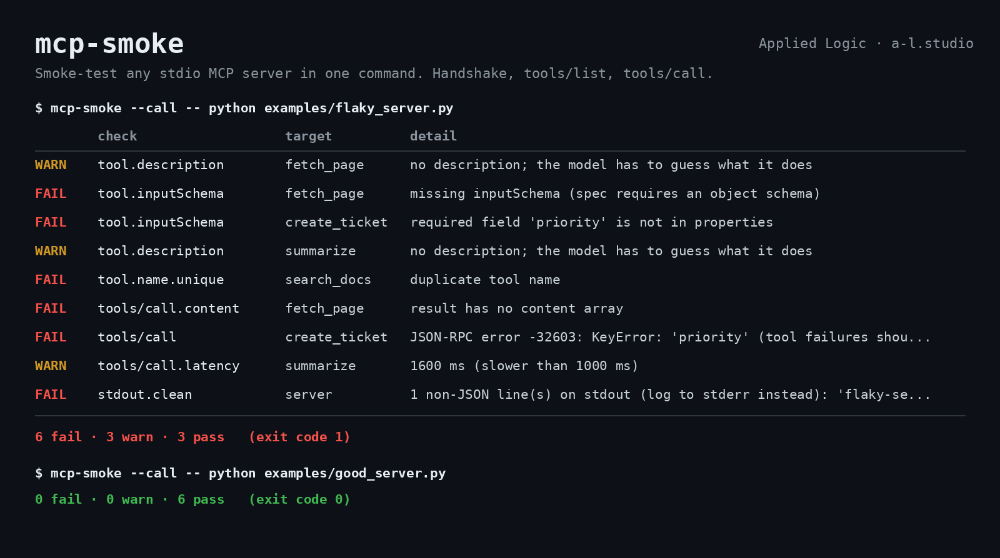

# mcp-smoke

Smoke-test any stdio MCP server in one command. It spawns the server, runs the `initialize` handshake, lists every tool, and (with `--call`) calls each one with sample arguments built from its own input schema. Then it tells you what's broken.

Standard library only. No API keys. Works on any MCP server you can start from a shell command, in any language.



## Quickstart

```bash
git clone https://github.com/jakehb1/mcp-smoke && cd mcp-smoke && python3 demo.py
```

That runs two bundled offline servers: a clean one, and a flaky one with the bugs people actually ship.

Point it at your own server:

```bash
pip install git+https://github.com/jakehb1/mcp-smoke
mcp-smoke -- python my_server.py               # handshake + tools/list only
mcp-smoke --call -- npx -y @some/mcp-server    # also call every tool
```

`--call` really calls your tools, so only use it on servers where that's safe, or narrow it with `--only <tool>`.

## What it checks

| Check | What it catches |
| --- | --- |
| `initialize` | Server crashes, hangs, or errors on the handshake. Missing `protocolVersion` or `serverInfo`. |
| `stdout.clean` | Anything on stdout that isn't JSON-RPC. A stray `print()` at startup breaks strict clients. Log to stderr. |
| `tools/list` | List errors, follows `nextCursor` pagination. |
| `tool.inputSchema` | Missing schema, `type` that isn't `object`, `required` fields that aren't in `properties`. |
| `tool.name.unique` | Two tools with the same name. |
| `tool.description` | Tools with no description (warn). The model has to guess what they do. |
| `tools/call` | Timeouts, JSON-RPC errors where the tool should have returned `isError`, results with no `content` array. |
| `tools/call.latency` | Calls slower than `--slow-ms` (default 1000, warn). |

Exit code is `1` if anything fails, so it drops straight into CI:

```bash
mcp-smoke --quiet -- python server.py || exit 1
mcp-smoke --json --call -- python server.py > smoke.json
```

## Demo output

```
mcp-smoke /usr/bin/python3 examples/flaky_server.py
  PASS  initialize                 server         flaky-server 0.0.3 in 12 ms
  PASS  tools/list                 server         5 tool(s) across 1 page(s)
  WARN  tool.description           fetch_page     no description; the model has to guess what it does
  FAIL  tool.inputSchema           fetch_page     missing inputSchema (spec requires an object schema)
  FAIL  tool.inputSchema           create_ticket  required field 'priority' is not in properties
  WARN  tool.description           summarize      no description; the model has to guess what it does
  FAIL  tool.name.unique           search_docs    duplicate tool name
  PASS  tools/call                 search_docs    ok in 0 ms
  FAIL  tools/call.content         fetch_page     result has no content array
  FAIL  tools/call                 create_ticket  JSON-RPC error -32603: KeyError: 'priority' (tool failures should return isError, not crash the call)
  WARN  tools/call.latency         summarize      1600 ms (slower than 1000 ms)
  FAIL  stdout.clean               server         1 non-JSON line(s) on stdout (log to stderr instead): 'flaky-server starting on stdio...'

6 fail, 3 warn, 3 pass
```

## Tests

```bash
python3 -m unittest discover -s tests
```

## Notes

- Speaks MCP's stdio transport (newline-delimited JSON-RPC 2.0). HTTP transports aren't covered yet.
- Sample arguments come from the schema: `default`, `enum`, `examples`, then a type-based value. Only required fields are filled.
- Pairs well with [tool-lint](https://github.com/jakehb1/tool-lint) (static checks on tool definitions) and [tool-gate](https://github.com/jakehb1/tool-gate) (policy gate for tool calls).

## Credits

Built by Jakeh Bradley at [Applied Logic](https://a-l.studio).

MIT License.
